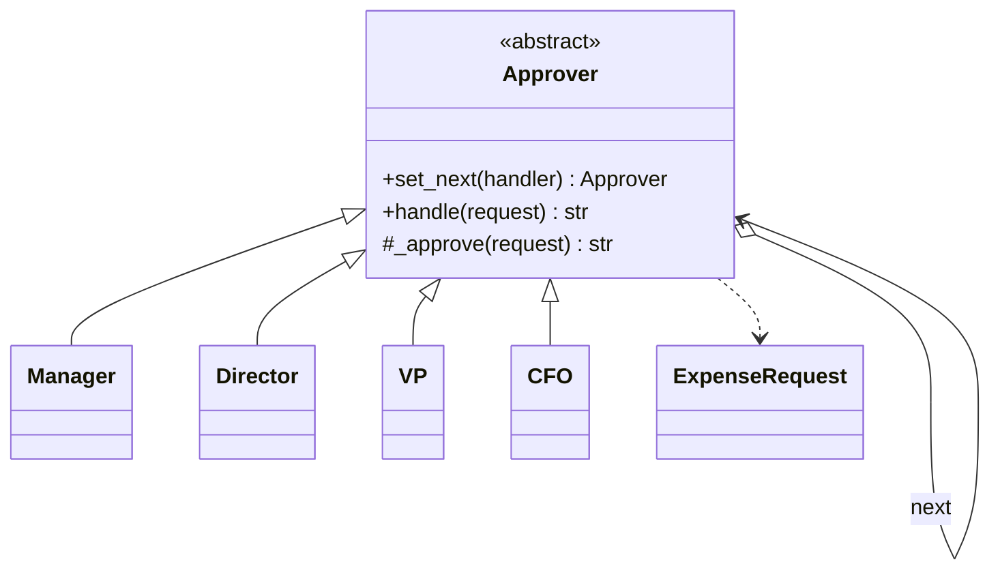

# Chain of Responsibility

## Intent
Pass a request along a chain of handlers; each decides to handle it or forward it.

## Problem
The sender should not hard-code which object processes a request, and the set of handlers should be configurable.

## Real-time use case
Expense approval: Manager (<=1k) -> Director (<=10k) -> VP (<=50k) -> CFO (<=250k). Larger amounts are rejected.

## UML

## Participants
- **Handler** (`Approver`): interface plus successor link and forwarding logic.
- **ConcreteHandler** (`Manager`, `Director`, `VP`, `CFO`): handle by limit.
- **Client**: builds the chain and submits `ExpenseRequest`s.

## When to use
- More than one object may handle a request, determined at runtime.
- Middleware pipelines, support escalation, approval workflows.

## Pros / Cons
- Pros: decouples sender from receivers; flexible chain order; open/closed.
- Cons: no guarantee a request is handled; harder to debug long chains.

## How to run
`python -m patterns.behavioral.chain_of_responsibility.demo`
