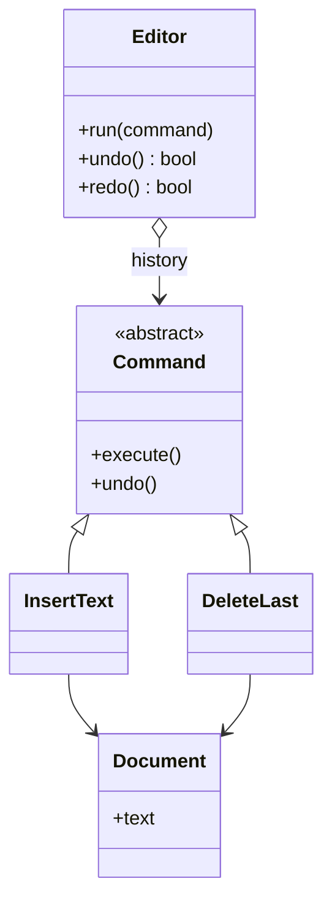

# Command

## Intent
Encapsulate a request as an object so it can be queued, logged, and undone.

## Problem
An editor's buttons and shortcuts must trigger operations and support undo/redo without knowing operation details.

## Real-time use case
Text-editor undo/redo: `InsertText` and `DeleteLast` commands run through an `Editor` invoker holding undo and redo stacks.

## UML

## Participants
- **Command** (`Command`): execute/undo interface.
- **ConcreteCommand** (`InsertText`, `DeleteLast`): bind a receiver to an action.
- **Receiver** (`Document`): does the actual work.
- **Invoker** (`Editor`): triggers commands and manages history.

## When to use
- Undo/redo, job queues, macros, transactional behavior, remote controls.

## Pros / Cons
- Pros: decouples invoker from receiver; undo/redo; composable; open/closed.
- Cons: many small classes; undo state must be captured carefully.

## How to run
`python -m patterns.behavioral.command.demo`
