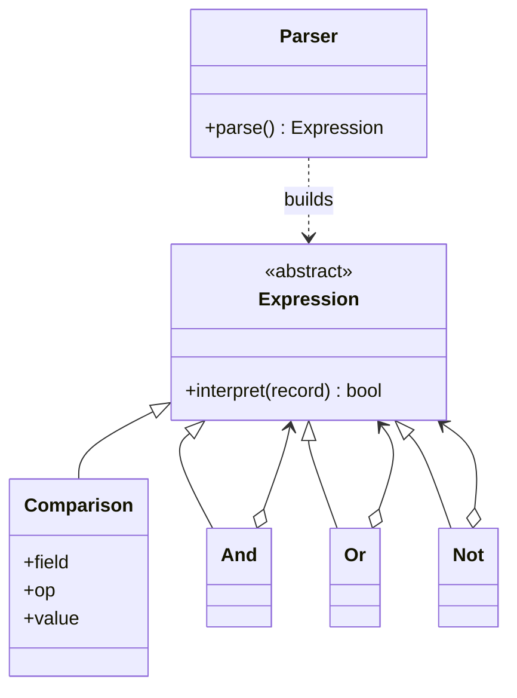

# Interpreter

## Intent
Define a grammar for a language and an interpreter that evaluates sentences in it.

## Problem
Business users need to express filter rules as text ("age > 30 AND country == 'IN'") without code changes.

## Real-time use case
A rule engine / search-filter DSL: a small recursive-descent parser builds an expression tree that is evaluated against records.

## UML

## Participants
- **AbstractExpression** (`Expression`): `interpret(context)`.
- **TerminalExpression** (`Comparison`): field/operator/literal test.
- **NonterminalExpression** (`And`, `Or`, `Not`): combine sub-expressions.
- **Context** (record dict): data the rule is evaluated on.
- **Client** (`Parser`/`parse`): builds the tree from text.

## When to use
- A simple, stable grammar that is evaluated repeatedly (rules, filters, query snippets).

## Pros / Cons
- Pros: easy to extend grammar with new expression classes; tree is reusable.
- Cons: large grammars become unwieldy; use a parser generator instead.

## How to run
`python -m patterns.behavioral.interpreter.demo`
