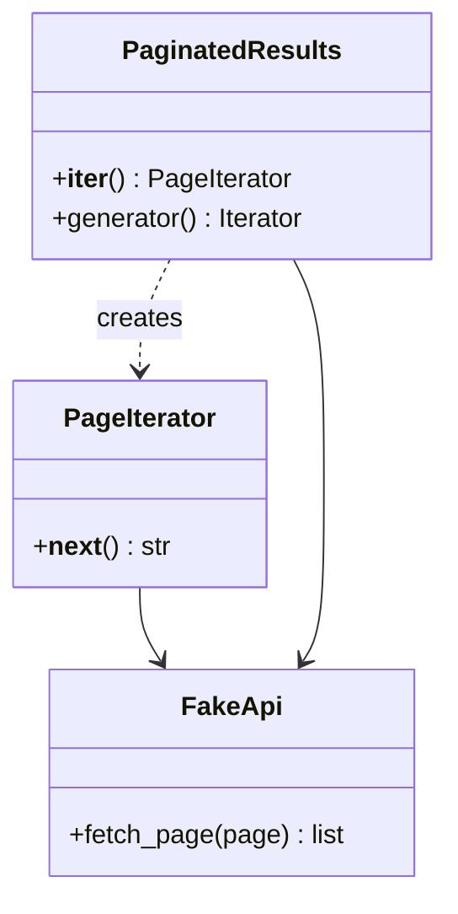

# Iterator

## Intent
Provide a way to access elements of a collection sequentially without exposing its representation.

## Problem
Results come from a paginated API. Clients want a simple `for` loop, without loading every page up front or knowing about page tokens.

## Real-time use case
`PaginatedResults` iterates items, fetching the next page lazily only when needed. A generator-based version shows the idiomatic Python form.

## UML

## Participants
- **Aggregate** (`PaginatedResults`): creates iterators.
- **Iterator / ConcreteIterator** (`PageIterator`, generator): track position and fetch lazily.
- **Client**: consumes items with `for`/`list`.

## When to use
- Hide a collection's structure, support multiple traversals, or lazily produce elements (pages, trees, playlists).

## Pros / Cons
- Pros: lazy loading; uniform interface; independent traversals.
- Cons: overkill for simple lists; iterator state can go stale if the source changes.

## How to run
`python -m patterns.behavioral.iterator.demo`
