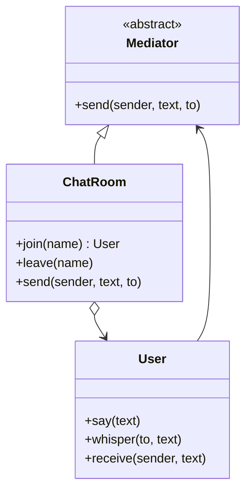

# Mediator

## Intent
Encapsulate how a set of objects interact so they do not refer to each other directly.

## Problem
In a chat, every user referencing every other user creates a tangled many-to-many web that is hard to change.

## Real-time use case
A `ChatRoom` mediator routes broadcast and private messages between `User` objects, which only know the room.

## UML

## Participants
- **Mediator** (`Mediator`): coordination interface.
- **ConcreteMediator** (`ChatRoom`): knows colleagues and routes messages.
- **Colleague** (`User`): talks only to the mediator.

## When to use
- Many objects interact in complex ways (chat, air-traffic control, UI widget coordination).

## Pros / Cons
- Pros: fewer dependencies between components; centralized interaction logic; easy to reuse colleagues.
- Cons: the mediator can become a "god object".

## How to run
`python -m patterns.behavioral.mediator.demo`
