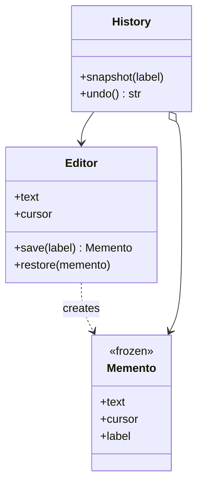

# Memento

## Intent
Capture and externalize an object's state so it can be restored later, without violating encapsulation.

## Problem
Users want to roll back to earlier drafts, but exposing the editor's internals to enable that would break encapsulation.

## Real-time use case
An `Editor` creates immutable `Memento` snapshots (text and cursor); a `History` caretaker stores them and restores the latest on undo.

## UML

## Participants
- **Originator** (`Editor`): produces and consumes snapshots.
- **Memento** (`Memento`): immutable state holder.
- **Caretaker** (`History`): keeps snapshots, never inspects them.

## When to use
- Undo, save points, form drafts, transaction rollback.

## Pros / Cons
- Pros: preserves encapsulation; simple rollback; originator stays clean.
- Cons: memory cost for large/many snapshots; caretaker must manage lifecycle.

## How to run
`python -m patterns.behavioral.memento.demo`
