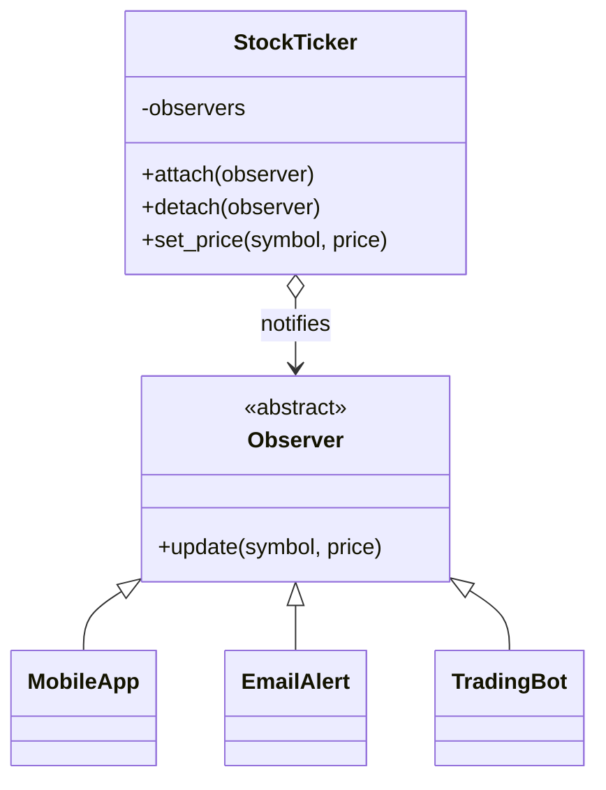

# Observer

## Intent
Define a one-to-many dependency so that when one object changes state, all its dependents are notified automatically.

## Problem
Several consumers (mobile push, email, trading bot) need to react to the same price feed. Hard-coding them into the feed couples it to every consumer and makes adding one an edit to the feed.

## Real-time use case
Stock-price alerts: `StockTicker` publishes prices; `MobileApp`, `EmailAlert`, and `TradingBot` subscribe and react independently. The same shape appears in event buses and pub/sub notifications.

## UML


## Participants
- **Observer** (`Observer`): update interface.
- **Subject** (`StockTicker`): holds observers and notifies them.
- **ConcreteObserver** (`MobileApp`, `EmailAlert`, `TradingBot`): react to updates in their own way.

## When to use
- A change in one object must trigger changes in an unknown or varying set of others.
- You need runtime subscribe/unsubscribe.

## Pros / Cons
- Pro: loose coupling; open for new observers.
- Pro: observers can be added/removed at runtime.
- Con: notification order is implicit; unexpected cascades are possible.
- Con: forgotten detaches leak memory/behaviour.

## How to run
```
python -m patterns.behavioral.observer.demo
```
