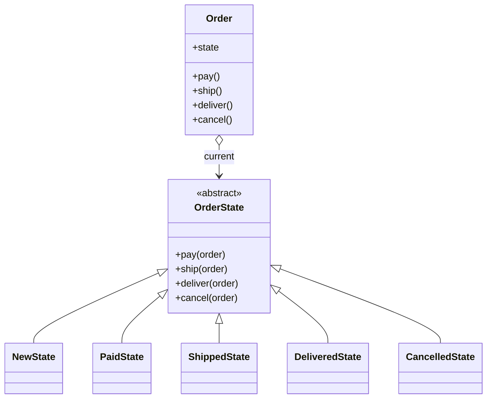
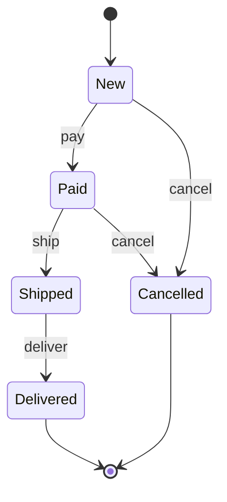

# State

## Intent
Let an object alter its behaviour when its internal state changes, so it appears to change class.

## Problem
An order's allowed actions depend on where it is in its lifecycle. Implementing that with `if status == ...` chains in every method is error-prone and grows with each new state.

## Real-time use case
Order lifecycle: `New -> Paid -> Shipped -> Delivered`, with `Cancelled` possible before shipping. Invalid transitions (e.g. shipping an unpaid order) are rejected. The same applies to vending machines, traffic lights and media players.

## UML




## Participants
- **Context** (`Order`): holds the current state and delegates to it.
- **State** (`OrderState`): interface; default rejects every action.
- **ConcreteState** (`NewState`, `PaidState`, `ShippedState`, `DeliveredState`, `CancelledState`): implement the allowed actions and perform transitions.

## When to use
- Behaviour depends on state and there are many state-specific conditionals.
- State transitions should be explicit and testable.

## Pros / Cons
- Pro: removes conditionals; one class per state; easy to add states.
- Pro: invalid transitions are centralised.
- Con: more classes for simple state machines.
- Con: transitions are spread across state classes.

## How to run
```
python -m patterns.behavioral.state.demo
```
