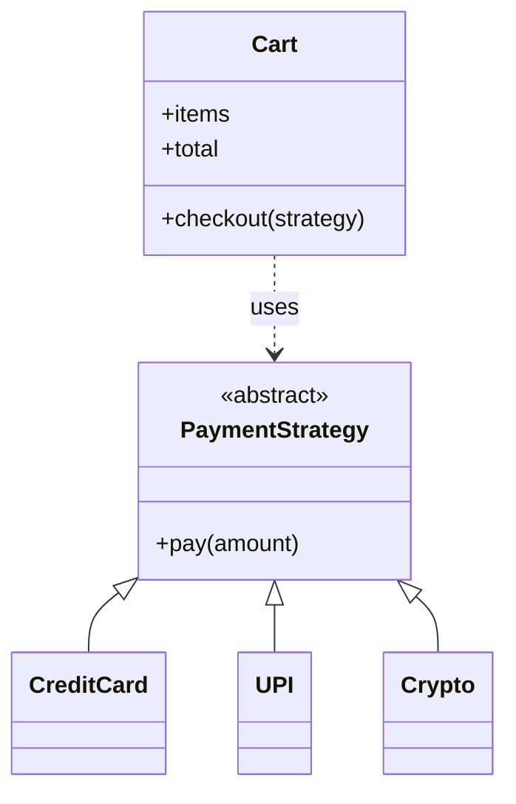

# Strategy

## Intent
Define a family of algorithms, encapsulate each one, and make them interchangeable at runtime.

## Problem
Checkout must support card, UPI, and crypto payments. An `if method == ...` chain inside `Cart` must be edited for every new method and mixes unrelated logic.

## Real-time use case
Payment methods at checkout. The same shape fits shipping-cost calculators, discount rules, sorting, and compression.

## UML


## Participants
- **Strategy** (`PaymentStrategy`): common algorithm interface.
- **ConcreteStrategy** (`CreditCard`, `UPI`, `Crypto`): the algorithms.
- **Context** (`Cart`): receives a strategy and delegates to it.

## When to use
- Several variants of one behaviour exist and must be selectable at runtime.
- You want to eliminate conditionals that choose between algorithms.

## Pros / Cons
- Pro: open/closed; algorithms are isolated and testable.
- Pro: swap at runtime.
- Con: clients must know the strategies to choose one.
- Con: for trivial cases a plain function is enough.

## How to run
```
python -m patterns.behavioral.strategy.demo
```
