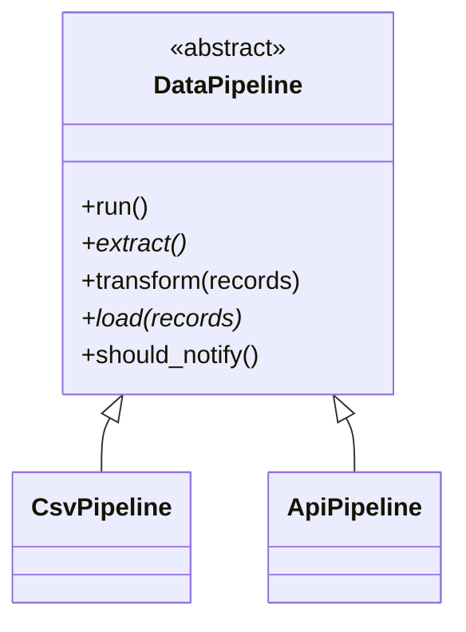

# Template Method

## Intent
Define the skeleton of an algorithm in a base class, deferring some steps to subclasses without changing the algorithm's structure.

## Problem
CSV and API ingestion share the same flow (extract, transform, load) but differ in details. Copy-pasting the flow duplicates it and lets the orderings drift.

## Real-time use case
ETL data pipelines: `DataPipeline.run()` fixes the order; `CsvPipeline` and `ApiPipeline` supply or override steps. Also fits report generation.

## UML


## Participants
- **AbstractClass** (`DataPipeline`): template method `run()`, abstract steps, default step and hook.
- **ConcreteClass** (`CsvPipeline`, `ApiPipeline`): implement/override the steps.

## When to use
- Several classes share an algorithm structure but vary in some steps.
- You want to control which steps subclasses may extend (hooks).

## Pros / Cons
- Pro: removes duplication; invariant order enforced in one place.
- Con: inheritance-based; tight base/subclass coupling.
- Con: many steps make the skeleton hard to follow.

## How to run
```
python -m patterns.behavioral.template_method.demo
```
