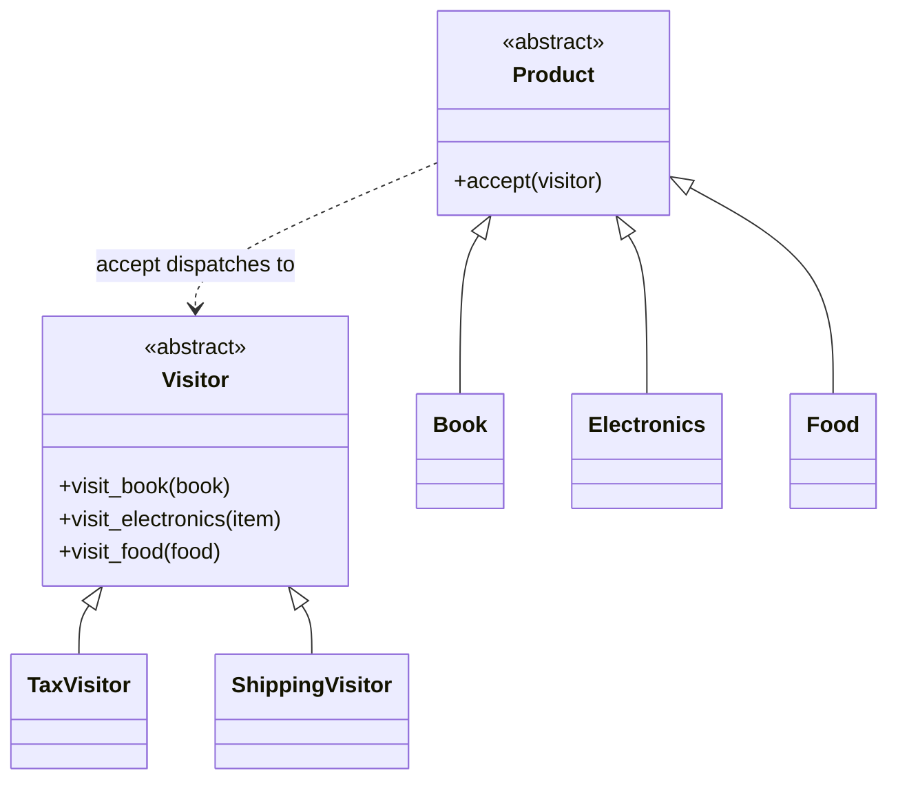

# Visitor

## Intent
Represent an operation to be performed on the elements of an object structure, so you can add new operations without changing the element classes.

## Problem
Tax, shipping, and later export or discount logic all depend on product type. Adding each as a method on `Book`, `Electronics`, and `Food` bloats them and forces edits on every new operation.

## Real-time use case
Tax calculation and shipping cost across product types. The same approach is used for AST operations and export formats.

## UML


## Participants
- **Visitor** (`Visitor`): a visit method per element type.
- **ConcreteVisitor** (`TaxVisitor`, `ShippingVisitor`): each implements one operation.
- **Element** (`Product`): declares `accept`.
- **ConcreteElement** (`Book`, `Electronics`, `Food`): call back the matching visit method (double dispatch).

## When to use
- Many distinct operations over a stable set of element types.
- You want to keep unrelated operations out of the element classes.

## Pros / Cons
- Pro: new operations are added without touching elements; related logic is grouped.
- Con: adding a new element type requires changing every visitor.
- Con: elements must expose enough state to the visitors.

## How to run
```
python -m patterns.behavioral.visitor.demo
```
