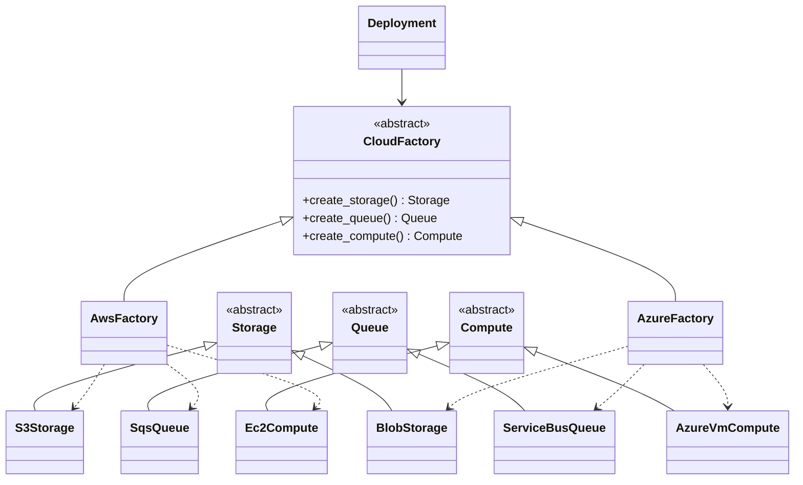

# Abstract Factory

## Intent
Provide an interface for creating families of related objects without naming their concrete classes.

## Problem
A deployment needs storage, a queue and compute that belong to the same cloud. Mixing S3 with Azure Service Bus would be invalid, and scattering provider checks through the code is brittle.

## Real-time use case
`CloudFactory` has an AWS and an Azure implementation. `Deployment` receives one factory and gets a matching `Storage` + `Queue` + `Compute`.

## UML


## Participants
- **Abstract factory (`CloudFactory`)**: one creation method per product type.
- **Concrete factories**: `AwsFactory`, `AzureFactory`.
- **Abstract products**: `Storage`, `Queue`, `Compute`.
- **Concrete products**: S3/SQS/EC2 and Blob/ServiceBus/VM.
- **Client (`Deployment`)**: uses only the abstract types.

## When to use
- Products must be used together as a family.
- The family (provider, theme, OS widget set) is chosen at runtime.

## Pros / Cons
- Pros: guarantees family consistency, isolates concrete classes, easy to swap families.
- Cons: adding a new product type means changing every factory.

## How to run
```
python -m patterns.creational.abstract_factory.demo
```
