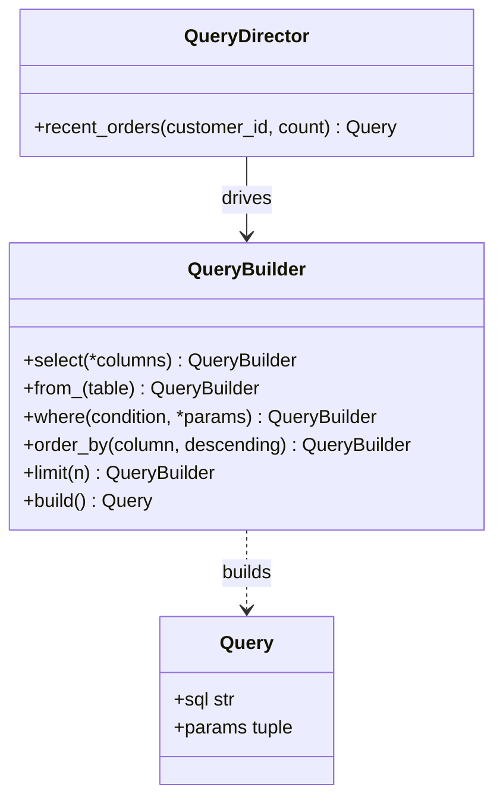

# Builder

## Intent
Separate the construction of a complex object from its representation so the same process can create different results.

## Problem
A SQL query has many optional parts (columns, filters, ordering, limit). A constructor with a dozen parameters, or string concatenation scattered around, is error-prone and unreadable.

## Real-time use case
`QueryBuilder().select(...).from_(...).where(...).limit(...).build()` produces an immutable `Query` with SQL text and bound parameters. A `QueryDirector` encapsulates recipes such as "recent orders for a customer".

## UML


## Participants
- **Builder (`QueryBuilder`)**: fluent step methods and `build()`.
- **Product (`Query`)**: the finished immutable object.
- **Director (`QueryDirector`)**: calls builder steps in a fixed order for common recipes.
- **Client**: uses the builder directly or via the director.

## When to use
- Objects with many optional parts or a multi-step construction process.
- You want validation at `build()` time and readable call sites.

## Pros / Cons
- Pros: readable, step-by-step construction, validation in one place, immutable products.
- Cons: extra classes; overkill for simple objects (dataclass defaults may suffice).

## How to run
```
python -m patterns.creational.builder.demo
```
