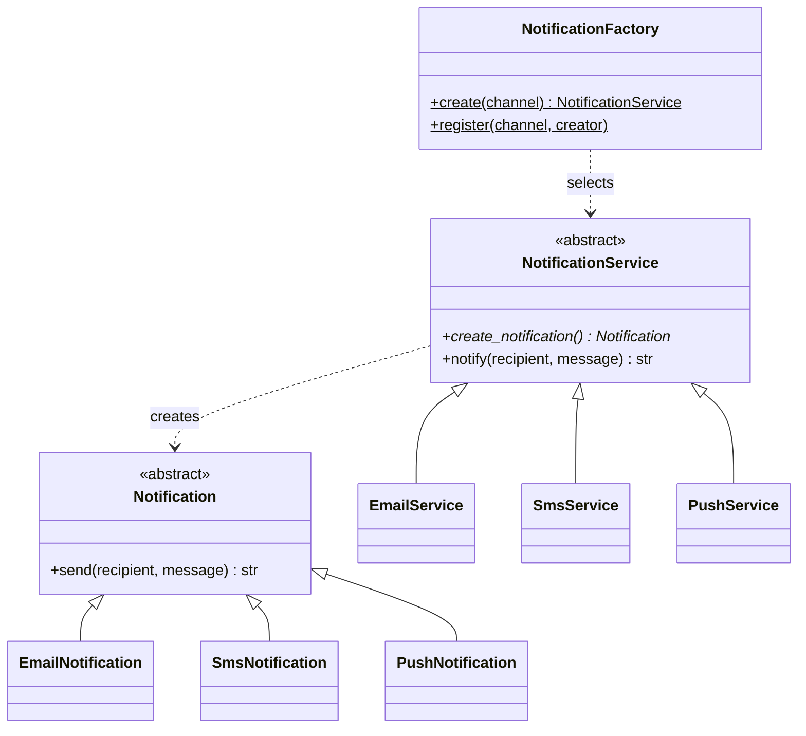

# Factory Method

## Intent
Define an interface for creating an object, but let subclasses decide which class to instantiate.

## Problem
A notification service must send email, SMS or push messages. Hard-coding `if channel == ...` and constructors in every caller couples them to all concrete senders.

## Real-time use case
`NotificationFactory.create("email" | "sms" | "push")` returns a service whose `create_notification()` factory method builds the right sender. Callers only use `notify()`.

## UML


## Participants
- **Product (`Notification`)**: common interface.
- **Concrete products**: `EmailNotification`, `SmsNotification`, `PushNotification`.
- **Creator (`NotificationService`)**: declares the factory method and uses it in `notify()`.
- **Concrete creators**: `EmailService`, `SmsService`, `PushService`.
- **`NotificationFactory`**: small registry that maps a channel name to a creator.

## When to use
- The exact class to build is only known at runtime or from configuration.
- You want new product types without editing existing client code.

## Pros / Cons
- Pros: loose coupling, open/closed for new channels, single place for creation logic.
- Cons: more classes; a registry or subclass per product.

## How to run
```
python -m patterns.creational.factory_method.demo
```
