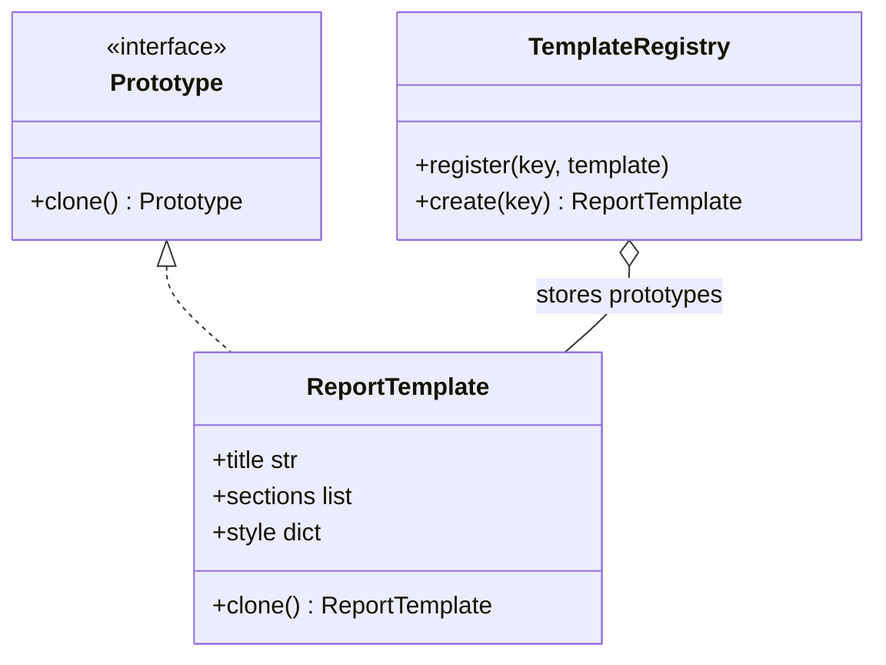

# Prototype

## Intent
Create new objects by copying an existing, pre-configured instance instead of building one from scratch.

## Problem
Report templates take effort to configure (sections, styles, branding). Rebuilding each variant from scratch repeats work, and copying carelessly (shallow copy) makes variants share mutable state.

## Real-time use case
A `TemplateRegistry` stores a "monthly" `ReportTemplate`. Each region clones it with `deepcopy` and customizes the clone without affecting the original.

## UML


## Participants
- **Prototype**: declares `clone()`.
- **Concrete prototype (`ReportTemplate`)**: implements cloning with a deep copy.
- **Client / registry (`TemplateRegistry`)**: keeps prototypes and produces clones on demand.

## When to use
- Object creation is costly or complex, and variants differ slightly.
- You want to avoid parallel factory hierarchies.

## Pros / Cons
- Pros: skips repeated setup, runtime-configurable catalog of templates, independent clones.
- Cons: deep copying objects with cycles or external resources (files, sockets) needs care.

## How to run
```
python -m patterns.creational.prototype.demo
```
