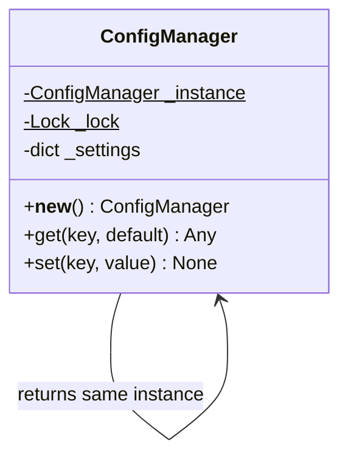

# Singleton

## Intent
Ensure a class has exactly one instance and provide a global access point to it.

## Problem
Application settings are expensive to load and must be consistent. If every module builds its own `ConfigManager`, you load the settings many times and the copies drift apart.

## Real-time use case
A `ConfigManager` loads settings once. The DB layer, API layer and workers all get the same instance, even under concurrent start-up.

## UML


## Participants
- **Singleton (`ConfigManager`)**: creates and guards its single instance via `__new__` with double-checked locking.
- **Clients** (any module): call `ConfigManager()` and receive the shared instance.

## When to use
- Exactly one shared resource: config, connection pool, logger, cache registry.
- Access must be controlled from one place.

## Pros / Cons
- Pros: one instance guaranteed, lazy initialization, thread-safe here.
- Cons: hidden global state, harder to unit test (hence `reset()`), couples clients to a concrete class. Consider dependency injection instead.

## How to run
```
python -m patterns.creational.singleton.demo
```
