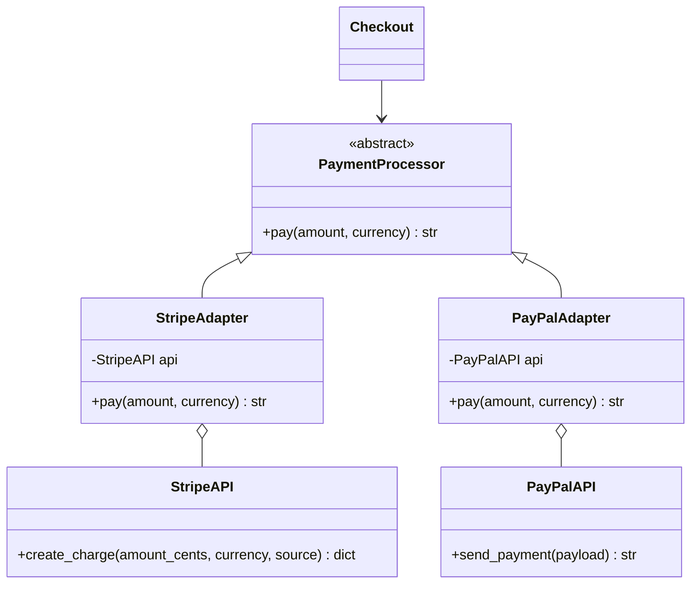

# Adapter

## Intent
Convert the interface of a class into another interface clients expect, so incompatible classes can work together.

## Problem
Stripe and PayPal SDKs have different method names, units and response shapes. Calling them directly spreads gateway-specific code through checkout and makes switching painful.

## Real-time use case
`StripeAdapter` and `PayPalAdapter` implement `PaymentProcessor.pay(amount, currency)`. `Checkout` works with either one.

## UML


## Participants
- **Target (`PaymentProcessor`)**: interface the client uses.
- **Adaptees (`StripeAPI`, `PayPalAPI`)**: existing incompatible APIs.
- **Adapters**: translate calls and results between target and adaptee.
- **Client (`Checkout`)**: depends only on the target.

## When to use
- Integrating third-party or legacy code you cannot modify.
- You want to isolate vendor specifics behind one interface.

## Pros / Cons
- Pros: single responsibility, add gateways without touching the client, easy to mock.
- Cons: extra layer; many adapters can add indirection.

## How to run
```
python -m patterns.structural.adapter.demo
```
