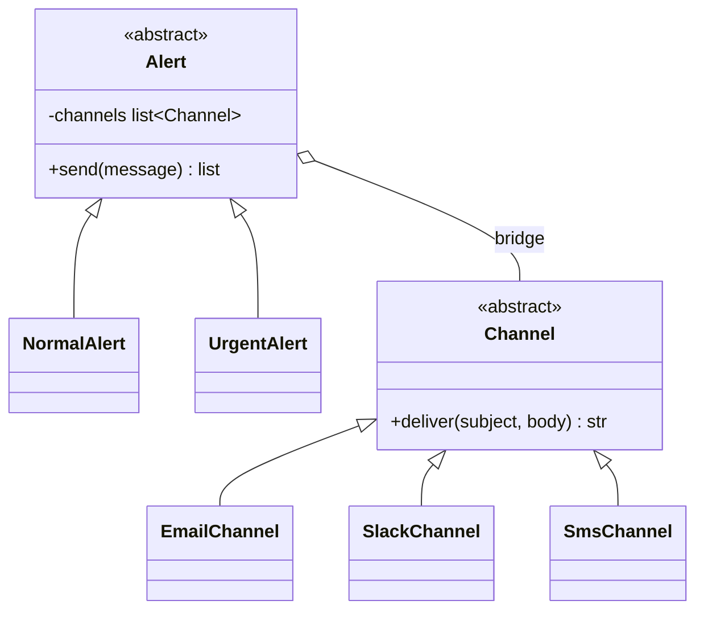

# Bridge

## Intent
Decouple an abstraction from its implementation so the two can vary independently.

## Problem
Alerts can be Normal or Urgent and can go out by Email, Slack or SMS. Subclassing every combination (`UrgentSlackAlert`, ...) explodes as M x N classes.

## Real-time use case
`Alert` (Normal/Urgent) holds a list of `Channel` objects (Email/Slack/SMS). Add a channel or an alert type without touching the other side.

## UML


## Participants
- **Abstraction (`Alert`)**: defines the high-level API and holds the bridge reference.
- **Refined abstractions**: `NormalAlert`, `UrgentAlert`.
- **Implementor (`Channel`)**: low-level delivery interface.
- **Concrete implementors**: `EmailChannel`, `SlackChannel`, `SmsChannel`.

## When to use
- Two orthogonal dimensions of variation (type x platform).
- You need to switch the implementation at runtime.

## Pros / Cons
- Pros: M + N classes instead of M x N, open/closed on both sides, runtime swapping.
- Cons: more upfront design; indirection for simple cases.

## How to run
```
python -m patterns.structural.bridge.demo
```
