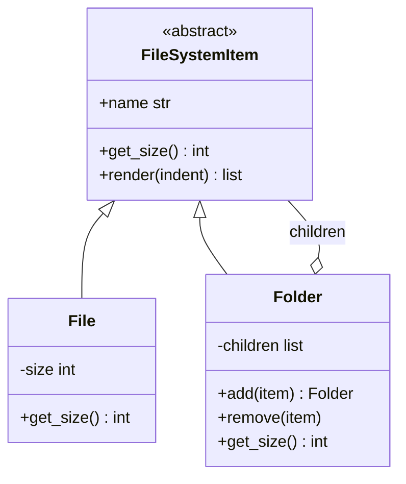

# Composite

## Intent
Compose objects into tree structures and let clients treat individual objects and compositions uniformly.

## Problem
A file system holds files and folders, and folders hold both. Calculating total size would otherwise need type checks and manual recursion in client code.

## Real-time use case
`File` and `Folder` implement `FileSystemItem`. `Folder.get_size()` sums its children recursively, so calling it on any node just works.

## UML


## Participants
- **Component (`FileSystemItem`)**: common interface.
- **Leaf (`File`)**: has no children; does the real work.
- **Composite (`Folder`)**: stores children and delegates operations to them.
- **Client**: uses the component interface only.

## When to use
- Part-whole hierarchies: file systems, org charts, UI trees, bundles in a cart.
- Clients should ignore the difference between a single item and a group.

## Pros / Cons
- Pros: uniform treatment, easy recursion, new node types fit in.
- Cons: the common interface can be overly general; restricting what a container may hold is harder.

## How to run
```
python -m patterns.structural.composite.demo
```
