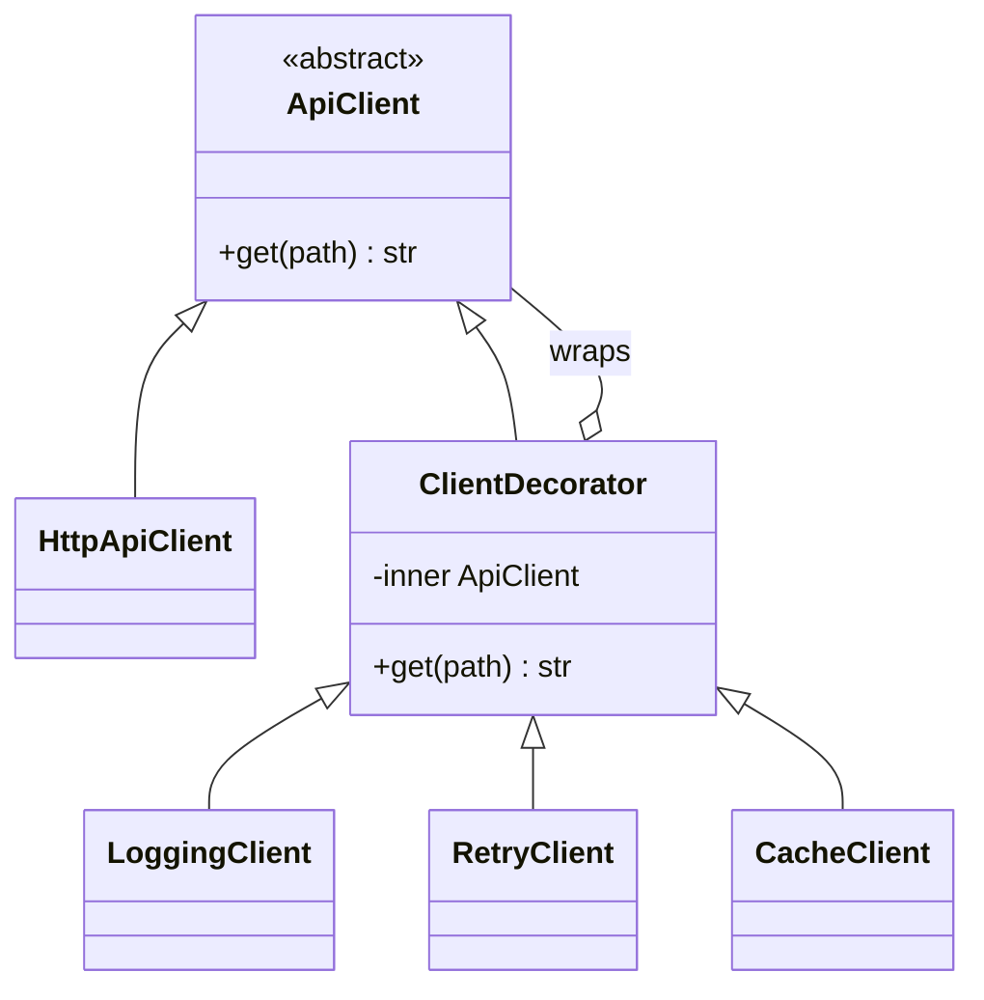

# Decorator

## Intent
Attach additional responsibilities to an object dynamically by wrapping it in objects with the same interface.

## Problem
An API client needs logging, retries and caching in various combinations. Subclasses for each combination explode, and editing the client for every concern breaks single responsibility.

## Real-time use case
`CacheClient(RetryClient(LoggingClient(HttpApiClient())))` stacks behaviours like request middleware. The module also shows Python function decorators (`@logged`, `@retry`).

## UML


## Participants
- **Component (`ApiClient`)**: common interface.
- **Concrete component (`HttpApiClient`)**: the real object.
- **Decorator (`ClientDecorator`)**: holds a wrapped component and forwards calls.
- **Concrete decorators**: `LoggingClient`, `RetryClient`, `CacheClient`.

## When to use
- Add or remove behaviour at runtime without subclassing.
- Cross-cutting concerns: logging, caching, auth, metrics, retries.

## Pros / Cons
- Pros: flexible composition, single-purpose classes, open/closed.
- Cons: order of wrappers matters; many small objects; hard to inspect the stack when debugging.

## How to run
```
python -m patterns.structural.decorator.demo
```
