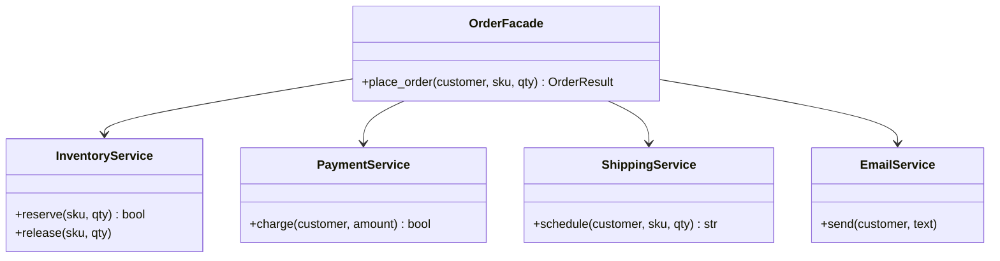

# Facade

## Intent
Provide a unified, simple interface to a set of interfaces in a subsystem.

## Problem
Placing an order touches inventory, payment, shipping and email, in a specific order and with compensation on failure. Every caller repeating that choreography is duplicated and fragile.

## Real-time use case
`OrderFacade.place_order(customer, sku, qty)` reserves stock, charges the customer, schedules shipping and sends email. If payment fails it releases the stock.

## UML


## Participants
- **Facade (`OrderFacade`)**: simple entry point that orchestrates the subsystems.
- **Subsystem classes**: `InventoryService`, `PaymentService`, `ShippingService`, `EmailService`.
- **Client**: calls the facade only.

## When to use
- A complex subsystem needs a simple, task-oriented API.
- You want to layer a system and reduce coupling to its internals.

## Pros / Cons
- Pros: simpler clients, lower coupling, one place for workflow rules.
- Cons: can grow into a god object; does not stop advanced users from reaching subsystems directly.

## How to run
```
python -m patterns.structural.facade.demo
```
