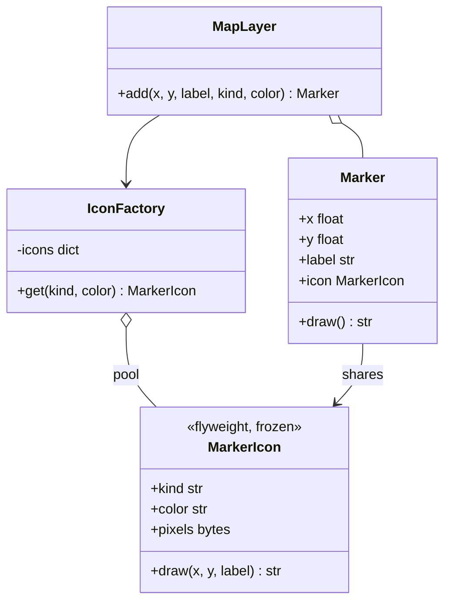

# Flyweight

## Intent
Use sharing to support large numbers of fine-grained objects efficiently.

## Problem
A map layer shows 100,000 points of interest. If each marker carries its own icon bitmap, memory explodes, yet only a handful of icon types exist.

## Real-time use case
`IconFactory` hands out one shared `MarkerIcon` per (kind, color). Each `Marker` stores only its position and label (extrinsic state) plus a reference to the shared icon.

## UML


## Participants
- **Flyweight (`MarkerIcon`)**: immutable intrinsic state, accepts extrinsic state in `draw()`.
- **Flyweight factory (`IconFactory`)**: pool that guarantees sharing.
- **Context (`Marker`)**: holds extrinsic state and a flyweight reference.
- **Client (`MapLayer`)**: creates markers through the factory.

## When to use
- Huge numbers of similar objects whose memory cost matters.
- Most object state can be made extrinsic and the shared part is immutable.

## Pros / Cons
- Pros: large memory savings, fewer allocations.
- Cons: extra complexity separating intrinsic and extrinsic state; flyweights must be immutable.

## How to run
```
python -m patterns.structural.flyweight.demo
```
