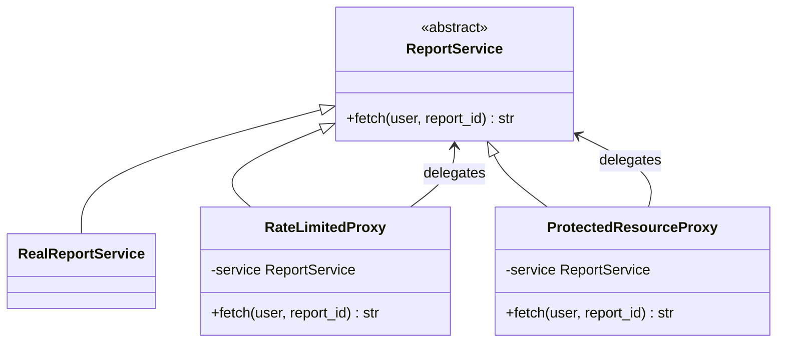

# Proxy

## Intent
Provide a surrogate for another object to control access to it.

## Problem
A report service is expensive and sensitive. Clients must not call it too often, and only admins may read reports. Embedding those rules in the service mixes concerns; embedding them in every client duplicates them.

## Real-time use case
`ProtectedResourceProxy` (role check) wraps `RateLimitedProxy` (N calls per time window per user), which wraps `RealReportService`. All three implement `ReportService`, so clients cannot tell the difference.

## UML


## Participants
- **Subject (`ReportService`)**: shared interface.
- **Real subject (`RealReportService`)**: does the actual work.
- **Proxies (`RateLimitedProxy`, `ProtectedResourceProxy`)**: check conditions, then delegate.
- **Client**: depends only on the subject.

## When to use
- Access control (protection proxy), rate limiting, caching, lazy loading (virtual proxy), remote calls (remote proxy), logging.

## Pros / Cons
- Pros: control without changing the real service or clients, open/closed, lifecycle management.
- Cons: extra indirection and latency; more classes.

Proxy vs Decorator: both wrap the same interface, but a proxy controls access to the object, while a decorator adds behaviour.

## How to run
```
python -m patterns.structural.proxy.demo
```
