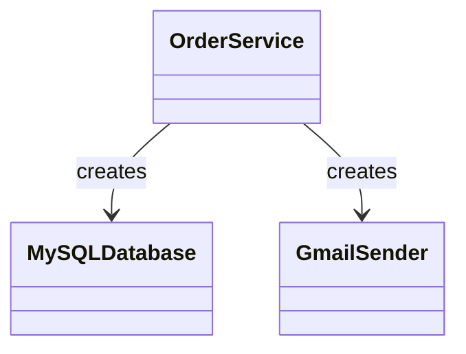
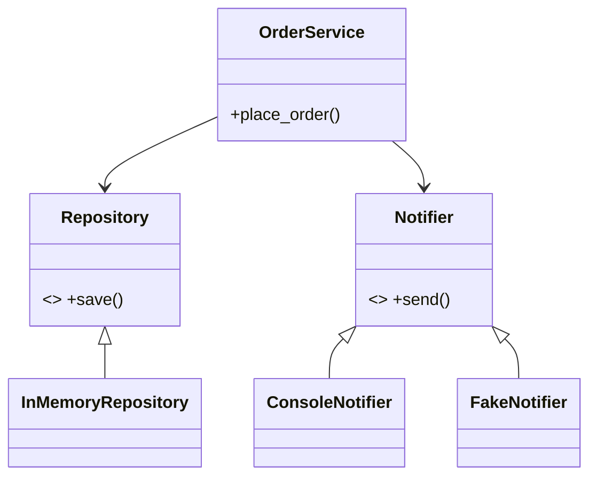

# DIP: Dependency Inversion Principle

**High-level modules should not depend on low-level modules; both should depend on abstractions.**

## Real-time scenario
An order service that saves orders to a database and sends confirmation messages.

## The violation (`bad.py`)
`OrderService.__init__` instantiates `MySQLDatabase` and `GmailSender`. The service cannot run or be unit-tested without those systems (the demo shows the `ConnectionError`), and swapping either means editing the service.

## The fix (`good.py`)
`OrderService` receives a `Repository` and a `Notifier` through its constructor. Production, console and fake implementations are interchangeable; tests inject `InMemoryRepository` and `FakeNotifier`.





## Related GoF patterns
Abstract Factory (build a family of dependencies), Observer (notify via abstraction), Bridge (decouple abstraction from implementation).

## How to run
```
python -m solid.dip_dependency_inversion.demo
```
