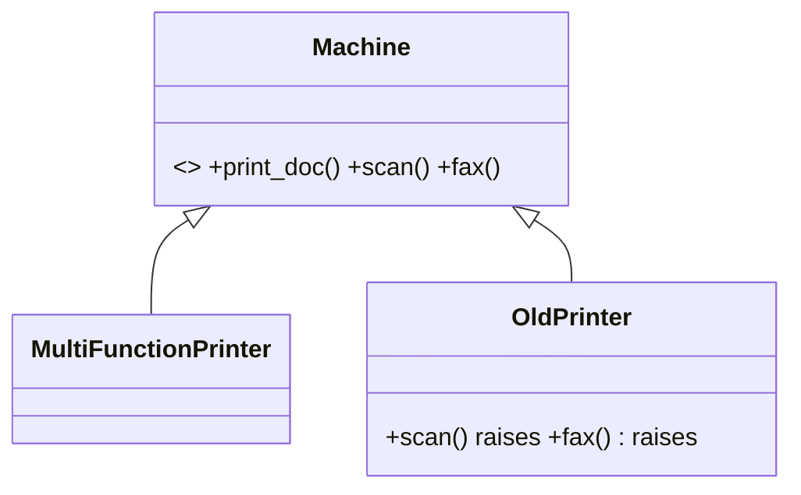
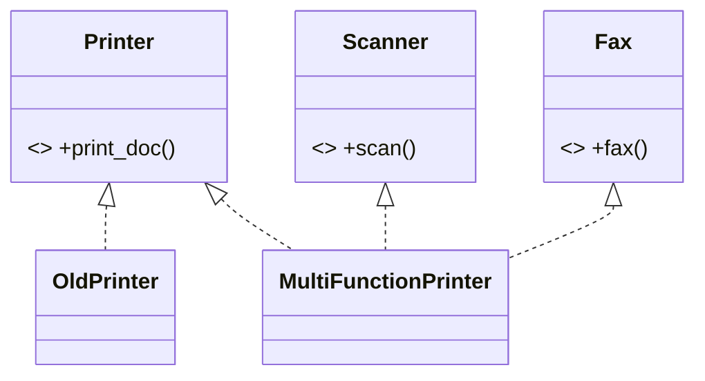

# ISP: Interface Segregation Principle

**Clients should not be forced to depend on methods they do not use.**

## Real-time scenario
Office devices: a simple printer and a multifunction printer that also scans and faxes.

## The violation (`bad.py`)
The fat `Machine` interface declares `print_doc`, `scan` and `fax`. `OldPrinter` must implement all three and raises `NotImplementedError` for two of them, so callers cannot trust the interface.

## The fix (`good.py`)
Three small `Protocol` roles: `Printer`, `Scanner`, `Fax`. Devices implement only what they support; clients ask for the role they need (`print_all` takes `Printer`s; `scan_all` selects `Scanner`s).





## Related GoF patterns
Adapter (expose a narrow interface over a wide one), Facade (a simple view of a big subsystem).

## How to run
```
python -m solid.isp_interface_segregation.demo
```
