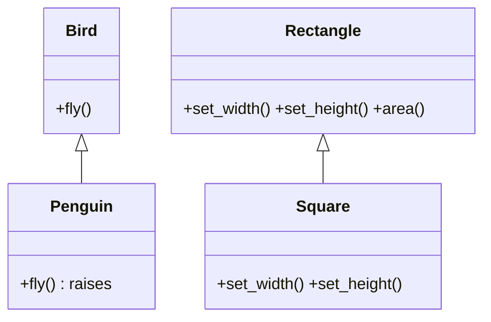
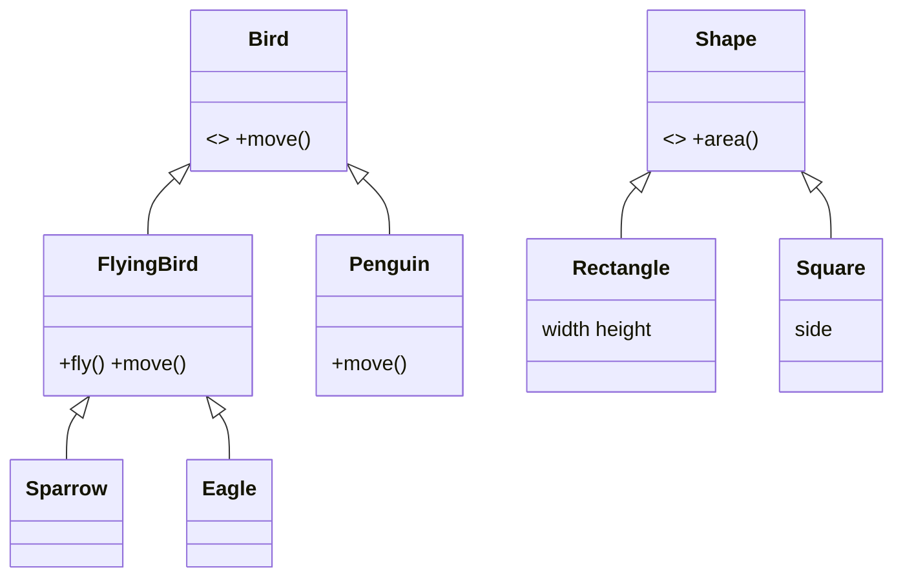

# LSP: Liskov Substitution Principle

**Subtypes must be substitutable for their base types without breaking the program's correctness.**

## Real-time scenario
Bird hierarchies and Rectangle/Square shapes, where client code written against the base class must keep working for every subclass.

## The violation (`bad.py`)
- `Penguin.fly()` raises, so a loop calling `fly()` on every `Bird` crashes.
- `Square` overrides `set_width`/`set_height` to change both sides, so code that sets 5x4 and expects area 20 gets 16.

## The fix (`good.py`)
- `Bird` only promises `move()`; `FlyingBird` adds `fly()`. `Penguin` is a `Bird`, not a `FlyingBird`.
- Shapes are immutable (`frozen` dataclasses) behind a `Shape.area()` contract, so there are no setters to violate.
- Tests in `tests/solid/test_solid.py` run a contract check over every concrete subclass found automatically.





## Related GoF patterns
Template Method (subclasses fill steps without changing the contract), Factory Method.

## How to run
```
python -m solid.lsp_liskov_substitution.demo
```
