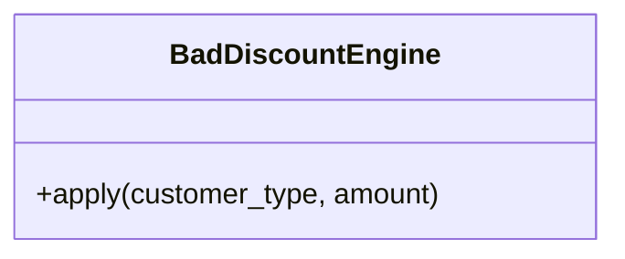
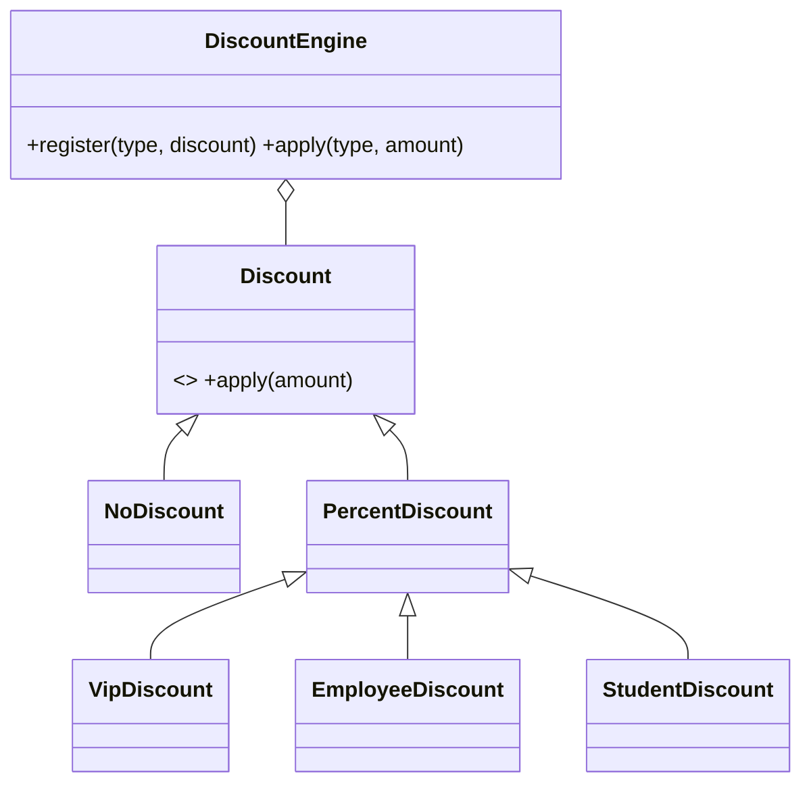

# OCP: Open/Closed Principle

**Software entities should be open for extension but closed for modification.**

## Real-time scenario
An e-commerce discount engine that must support new customer types (VIP, employee, student, ...).

## The violation (`bad.py`)
`DiscountEngine.apply` is an `if/elif` chain on `customer_type`. Every new type edits the function and forces re-testing of every existing branch; an unknown type simply fails.

## The fix (`good.py`)
A `Discount` abstraction with one class per rule. `DiscountEngine` looks discounts up in a registry, so `StudentDiscount` is added by registering it, with no edit to existing code.





## Related GoF patterns
Strategy (interchangeable discount rules), Decorator (stackable discounts), Visitor (add operations without editing classes).

## How to run
```
python -m solid.ocp_open_closed.demo
```
