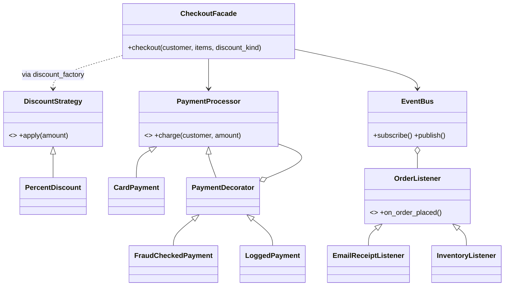

# Putting it together: e-commerce checkout

**Principle statement:** SOLID principles rarely appear alone; design patterns are how they show up in real systems.

## Real-time scenario
A checkout flow: price the cart with a discount, charge a payment, then tell the rest of the system.

## How the patterns map to SOLID (`system.py`)

| Pattern | Where | SOLID satisfied |
|---|---|---|
| Strategy | `DiscountStrategy` / `PercentDiscount` | OCP: new rules are new classes |
| Factory | `discount_factory` | SRP (creation in one place), DIP (callers get the abstraction) |
| Decorator | `FraudCheckedPayment`, `LoggedPayment` around `CardPayment` | OCP (add behaviour without editing), LSP (each is a `PaymentProcessor`) |
| Observer | `EventBus`, `EmailReceiptListener`, `InventoryListener` | OCP (add listeners freely), ISP (one-method listener) |
| Facade | `CheckoutFacade.checkout()` | SRP (orchestration only), DIP (injected collaborators) |

## Violation vs fix
A single `checkout()` function doing pricing `if/elif`, card charging, fraud checks, email and stock updates would violate all five principles. Here each concern is a small replaceable object.



## Related GoF patterns
Strategy, Factory Method, Observer, Decorator, Facade.

## How to run
```
python -m solid.putting_it_together.demo
```
