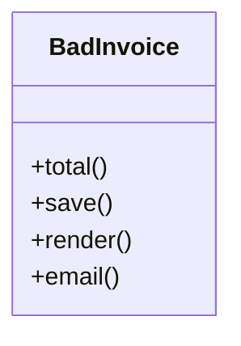
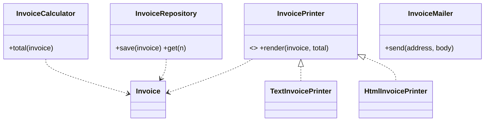

# SRP: Single Responsibility Principle

**A class should have one, and only one, reason to change.**

## Real-time scenario
An invoicing module that calculates totals, stores invoices, renders them and emails them.

## The violation (`bad.py`)
`Invoice` mixes pricing, persistence, presentation and delivery. A new "HTML invoice" requirement, a database swap or a tax-rule change all edit the same class, so each change risks breaking the other three concerns.

## The fix (`good.py`)
`Invoice` is plain data. `InvoiceCalculator`, `InvoiceRepository`, `InvoicePrinter` (Text/Html) and `InvoiceMailer` each own one concern. Adding HTML output is a new class.





## Related GoF patterns
Facade (one entry point over the split classes), Command (each operation as its own object).

## How to run
```
python -m solid.srp_single_responsibility.demo
```
